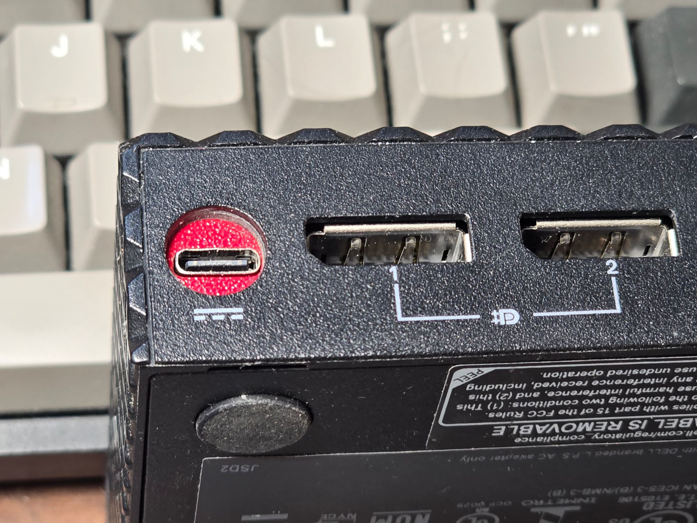
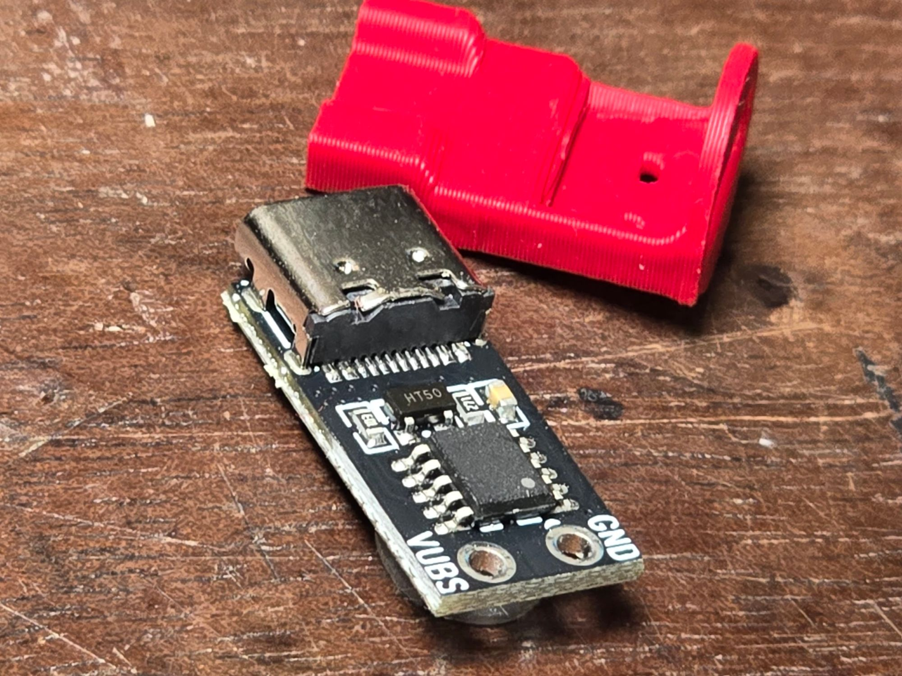
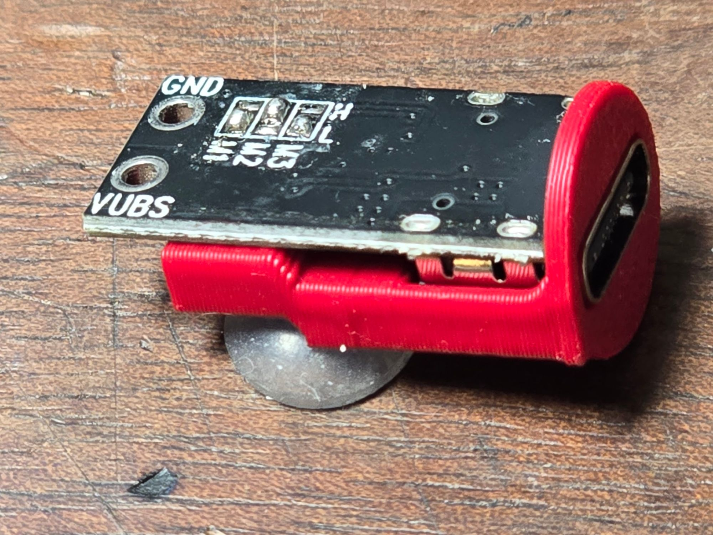
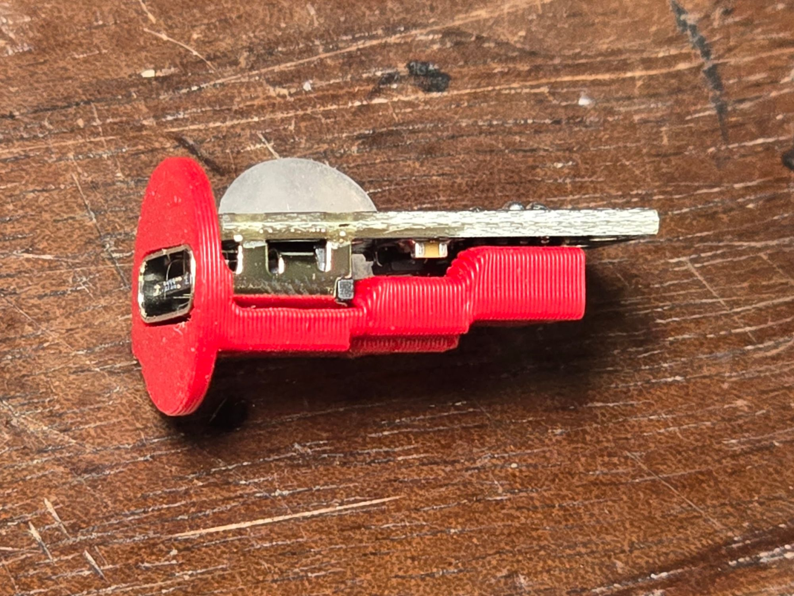

# USB-C power mod

This mod replaces the Wyse 3040's barrel-jack power input with **USB-C**. A small USB-C "decoy"
board (also called a PD trigger) sits where the barrel jack was. It asks the charger for the voltage
your 3040 expects. A printed bracket holds the board in place, and its round flange fills the old jack
opening.

Designed by George Stephanis.

## Files

| File | What |
|------|------|
| [`wyse-3040-usb-c.f3d`](wyse-3040-usb-c.f3d) | Fusion 360 source. Edit this one |
| [`wyse-3040-usb-c-fdm.step`](wyse-3040-usb-c-fdm.step) | Filament (FDM) version: screw holes for M1.2–M1.4 screws |
| [`wyse-3040-usb-c-sla-resin.step`](wyse-3040-usb-c-sla-resin.step) | Resin (SLA/MSLA) version: alignment pegs |

The two STEP files are the same bracket. The only difference is how it locates on the 3040's
motherboard:

- **Filament (FDM):** two through-holes. A tiny **M1.2–M1.4 screw** goes through each one and threads
  into the motherboard's holes.
- **Resin (SLA):** two small **pegs** on the underside instead of holes. They drop into the same two
  motherboard holes for alignment.

The screw version is meant for FDM printing, where pegs that small don't come out cleanly. Resin
prints them crisply.

## Decoy board

- **Board:** [Aideepen USB-C PD Trigger Board](https://www.alibaba.com/product-detail/Aideepen-USB-C-PD-Trigger-Board_1601821179962.html),
  **SKU GXJA0639-001**. The parts are modelled on this exact variant, whose USB-C socket sticks out about
  **1 mm past the board edge**. Other SKUs or lookalike boards with a different socket position or board
  size won't seat correctly.
- **Voltage:** the board's output voltage is set by the solder-jumper pads on its back, marked **1 / 2 / 3**
  and **H / L**. Check the board's listing for which combination gives which voltage.
- **Charger:** use one that supports USB-C PD at your 3040's voltage and can supply enough current, with some
  margin for USB peripherals. 12 V units shipped with a 24 W (12 V, 2 A) adapter, so look for a charger
  whose label lists **12 V at 2 A or more**. 12 V is optional in USB PD: many chargers only offer 5, 9,
  15 and 20 V, and won't work for a 12 V unit.

> [!WARNING]
> **Test the voltage before you connect it to the 3040.**
>
> 1. Check what your 3040 expects. Read the input rating on the label on the case, or on the original
>    power adapter. Depending on the variant, that's 5 V or 12 V.
> 2. Set the decoy board's jumpers for that voltage.
> 3. Plug the board into the USB-C charger you'll actually use, and measure across the **VBUS** and
>    **GND** pads with a multimeter. VBUS is printed `VUBS` on this board.
> 4. Only wire it in if the reading matches your unit's rating.
>
> The wrong voltage can permanently damage the 3040. Not every charger offers every PD voltage, and some
> fall back to 5 V, so measure again if you switch chargers.

## Fitting

The board slides into the bracket component-side down. The USB-C socket sits in the flange's cut-out,
which is why the parts are modelled on this SKU's socket sticking out about 1 mm past the board edge.
The **VBUS** and **GND** pads stay exposed at the far end of the bracket, ready for the power leads.

The bracket locates on two holes in the 3040's motherboard. The filament version screws into them with
M1.2–M1.4 screws, and the resin version's pegs drop into them. The red print in the photos is the
filament version, and its screw hole is visible on the flange side.

_TODO: steps for removing the barrel jack, and where VBUS and GND solder onto the 3040's board._

## Print notes

**Filament (FDM) version:**

| Setting      | Value |
|--------------|-------|
| Material     | PETG |
| Layer height | 0.2 mm |
| Infill       | 100%. It's a small part, and strength matters more than print time |
| Orientation  | USB-C socket opening facing **down**, flange flat on the bed |
| Supports     | Some support helps |

**Resin (SLA) version:** _TODO._

## License

Copyright © 2026 George Stephanis.

These designs are licensed under the **CERN Open Hardware Licence Version 2 – Strongly Reciprocal**
(CERN-OHL-S-2.0); the full text is in [`LICENSE`](LICENSE). You may use, modify, print and sell them.
If you distribute modified designs, or products made from them, you must make your design source available
under the same license. For these parts, the design source is the Fusion 360 file.

Source location: <https://github.com/georgestephanis/Wyse3040/tree/main/hardware/usb-c-power>
